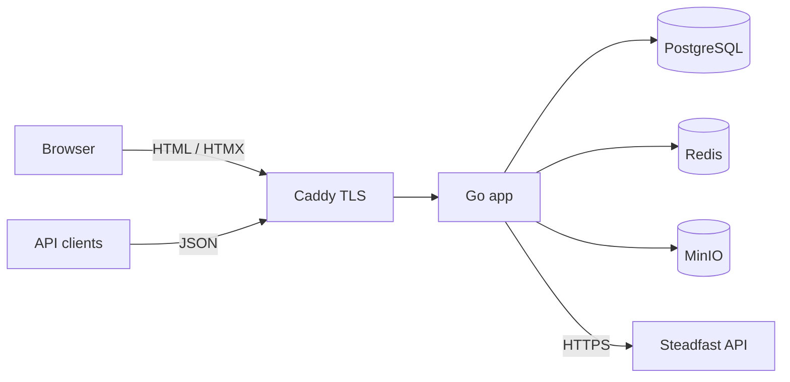

# Architecture

## Overview

One Go binary serves three surfaces from one PostgreSQL database:

| Surface | Path | Rendering | Auth |
|---|---|---|---|
| Storefront | `/` | Server-rendered `html/template` + HTMX | none (guest) |
| Admin dashboard | `/admin` | Server-rendered `html/template` + HTMX | session + RBAC |
| Public JSON API | `/api/v1` | JSON | none (rate-limited) |



- **PostgreSQL** is the source of truth: catalog, orders, inventory ledger, sessions, audit log.
- **Redis** holds rate-limit counters and a short-lived catalog/homepage cache. Losing Redis is harmless: rate limiting fails open and the cache becomes a miss.
- **MinIO** stores product, category and campaign images in a private bucket. The app serves them at `/media/<key>` with immutable cache headers.
- **Steadfast** is called only by the server; credentials never reach the browser.

## Package layout

```
cmd/server            entry point: serve | migrate | seed | create-admin
internal/config       environment configuration
internal/db           pgx pool, embedded goose migrations, tx helper
internal/server       HTTP layer: routing, middleware, handlers, template rendering
internal/catalog      categories, products, variants, images, search/filter
internal/offers       campaigns (validation, CRUD); pricing applied in SQL by best_offer()
internal/orders       cart pricing (Quote), checkout, order state machine, customers, CSV
internal/inventory    stock reserve/release/ship/return/adjust + movement ledger
internal/courier      Steadfast consignments, reconciliation, status sync
internal/courier/steadfast  HTTP client limited to documented endpoints
internal/reports      dashboard statistics
internal/settings     store settings + delivery zones (cached in memory)
internal/auth         admins, bcrypt, roles → permissions
internal/audit        audit log writer/reader
internal/media        MinIO storage, image validation/resize/thumbnail
internal/cache        versioned Redis JSON cache
internal/money|phone|slug|paging   small pure helpers
web/                  embedded templates, static assets, OpenAPI spec
```

Handlers parse input, call a service and render. Business rules live in the service packages and are tested there without HTTP.

## Key flows

### Pricing

The effective price of a product is `LEAST(selling_price, best running campaign price)`. It comes from the SQL function `best_offer()`, which runs in the same query that lists, filters and sorts products. Price filters and sorting therefore use the price the customer actually pays.

The browser cart holds only `{sku, qty}`. Every cart view, and checkout itself, recomputes the prices on the server.

### Checkout (atomic)

```mermaid
sequenceDiagram
  participant B as Browser
  participant S as Server
  participant DB as PostgreSQL
  B->>S: POST /checkout (form + cart JSON + idempotency key)
  S->>S: validate fields, BD phone
  S->>DB: existing order for key? → return it
  S->>DB: BEGIN
  S->>DB: SELECT … FOR UPDATE variants (sorted, no deadlocks)
  S->>DB: re-price cart (offers, zone, free-delivery threshold)
  S->>DB: upsert customer by phone
  S->>DB: INSERT order (+ unique idempotency_key), items (snapshots)
  S->>DB: UPDATE variants SET reserved += q WHERE stock - reserved >= q
  S->>DB: INSERT status history; COMMIT
  S-->>B: 303 → /order/{number}?t=HMAC
```

Any change in price or stock rolls the transaction back and returns "cart changed". When two duplicate submissions race, the loser hits the unique constraint and gets the winner's order back.

### Order state machine and inventory

```
pending → confirmed → processing → ready_to_ship → shipped → in_transit → delivered
   └──────────┴────────────┴─────────────┴─→ cancelled        shipped/in_transit/delivered → returned
```

| Transition | Inventory effect |
|---|---|
| order placed | `reserved += q` |
| → cancelled | `reserved -= q` (release) |
| → shipped | `stock -= q`, `reserved -= q`, `sold_count += q` |
| → returned | `stock += q`, `sold_count -= q`, payment `refunded` |
| → delivered | payment `paid` (COD collected) |

Every change writes `inventory_movements` and `order_status_history`, recording which admin made it.

### Steadfast courier

See [steadfast.md](steadfast.md).

## Security

- **Admin access:**
  - bcrypt hashes
  - server-side sessions in Postgres, with the token renewed at login and on password change, an idle timeout, and `HttpOnly`/`SameSite=Lax` cookies (plus `Secure` in production)
  - roles and permissions checked on every route, with the admin reloaded from the database on every request so a deactivated account loses access immediately
  - the last active admin can't be demoted or deactivated
- **CSRF and browser hardening:**
  - CSRF tokens (nosurf) on all HTML POSTs, plus Origin/Referer checks
  - a strict CSP with no inline scripts; HTMX runs with `allowEval: false`
  - `html/template` contextual escaping
- **Rate limits:** Redis fixed windows on checkout, tracking, admin login and the API. The client IP is taken from proxy headers only when `TRUST_PROXY=true`.
- **Uploads:**
  - the file type is detected from its content
  - pixel-count limit
  - re-encoded, which strips EXIF data
  - random object names, in a private bucket
- **Data exposure:**
  - order confirmation pages need an HMAC token
  - tracking needs both order number and phone, and gives the same answer whether the order or the phone is wrong
  - internal database IDs never appear in the public API
- **Database and exports:** all SQL is parameterised, and CSV exports neutralise formula injection.

## Caching

The homepage sections and the category tree are cached in Redis for `CACHE_TTL`. Every successful admin POST increments a version counter, so all cache keys change at once without scanning. Checkout never reads the cache.
