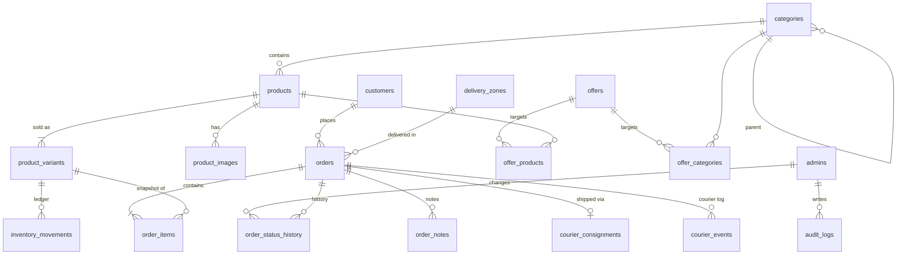

# Database schema

Migrations live in `internal/db/migrations` (goose), are embedded in the binary, and run on startup when `AUTO_MIGRATE=true`, or with `server migrate`.

**Conventions:**
- Money columns are `BIGINT` poisha.
- Timestamps are `timestamptz`.
- Catalog tables use soft deletion (`deleted_at`), with partial unique indexes so a deleted slug or SKU can be reused.

| Table | Purpose / notable constraints |
|---|---|
| `admins` | Unique `lower(email)`; role is `admin` or `staff`; bcrypt hash |
| `sessions` | scs session store (token, data, expiry) |
| `audit_logs` | Who did what, with JSON details and IP |
| `categories` | Two levels (`parent_id`); unique slug among non-deleted rows |
| `products` | Unique slug and SKU among non-deleted rows; `selling_price <= regular_price`; generated `tsvector` for search, plus a trigram index on name |
| `product_images` | MinIO object keys, ordered (first image is the cover) |
| `product_variants` | Unique SKU; `stock >= reserved >= 0`; low-stock threshold |
| `inventory_movements` | Every stock or reservation change, with values after the change, the order and the admin |
| `offers` | Percent (1–90) or fixed (poisha) discount; `ends_at > starts_at` |
| `offer_products`, `offer_categories` | Campaign targets |
| `customers` | One row per phone number (`customers_phone_uq`), updated on every order |
| `delivery_zones` | Name and charge |
| `orders` | Unique `order_number` and `idempotency_key`; totals frozen at checkout |
| `order_items` | Snapshot of product name, variant, SKU, image, prices and offer title |
| `order_status_history` | from → to, note, admin (null = customer or system) |
| `order_notes` | Internal notes |
| `courier_consignments` | One per order (unique `order_id`); state `creating`/`created`/`failed`; Steadfast `consignment_id` and `tracking_code` |
| `courier_events` | Raw request and response of every Steadfast call |
| `store_settings` | Key/value: store info, banner text, free-delivery threshold, COD switch, homepage sections, policies |

**SQL function `best_offer(product_id, category_id, regular_price)`:** returns the cheapest campaign that is running now for a product, matching either a product target or a category target (including the parent category).

**Indexes:** besides the primary and foreign keys, there are indexes on:
- order phone, status and created_at
- the product search vector and trigram name
- variant and image product IDs
- offers by active window
- consignments due for sync
